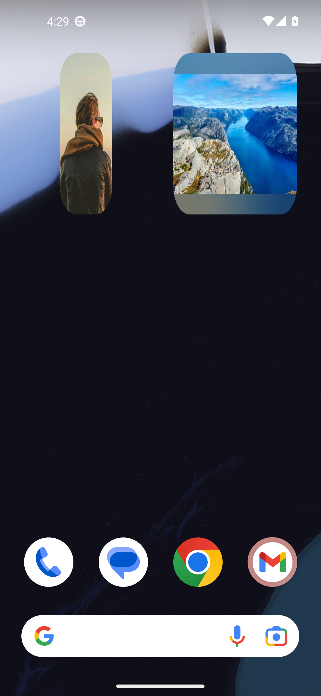
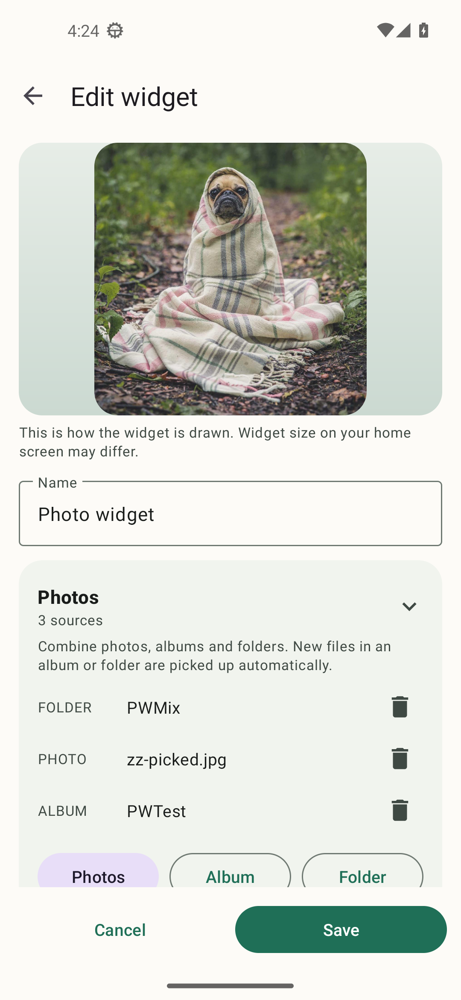
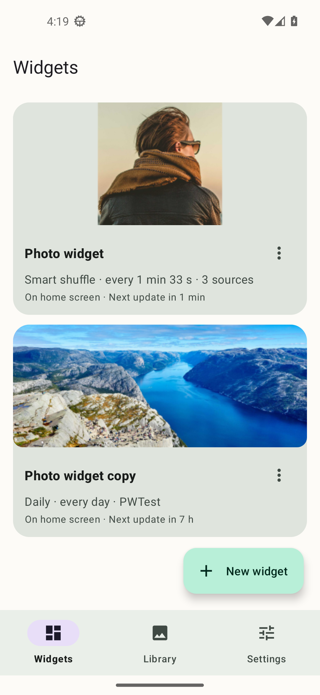
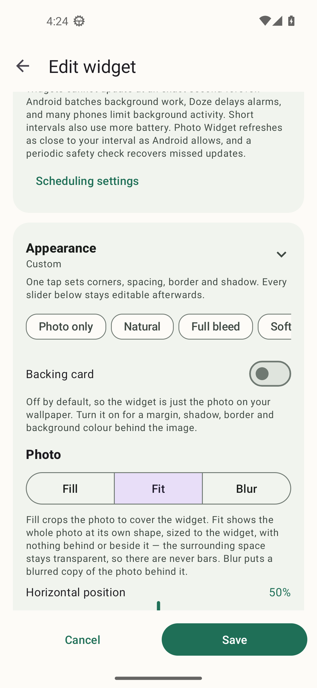
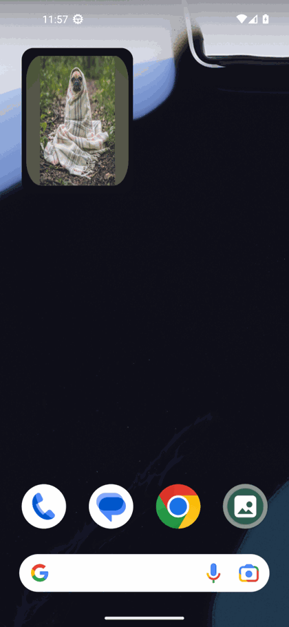
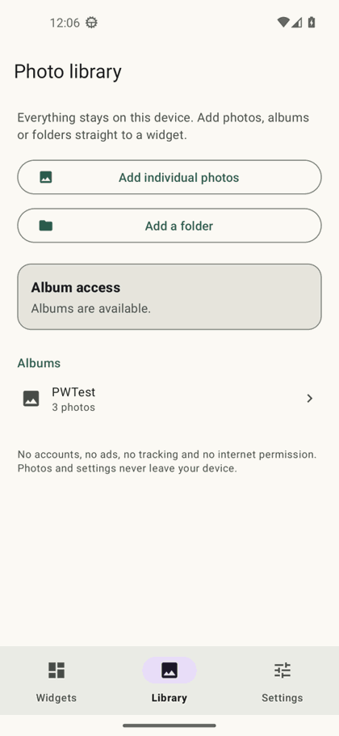

# Photo Widget

A free, open-source, offline photo widget for Android. No ads, no accounts, no
subscriptions, no telemetry and no internet permission. Put your own photos on your
home screen, exactly how you want them.

* **License:** GNU General Public License v3 — see [LICENSE](LICENSE)
* **Minimum Android:** 8.0 (API 26)
* **Compiled against:** Android 15 (API 35), AGP 8.7.3, Gradle 8.9, Kotlin 2.0.21, JDK 17
* **Verified on:** Android 13 (API 33) emulator — see *Testing on a device* below
* **Download:** [Releases](https://github.com/TheMonkey1212/photowidget/releases) —
  `PhotoWidget-1.2.0-debug.apk` (debug-signed, see below)

| Home screen: Fit (just the photo) and Blur fill | Configure screen with live preview |
| --- | --- |
|  |  |

| Widget list with hero previews | Style presets |
| --- | --- |
|  |  |

| Blur Fill widget | Photo library |
| --- | --- |
|  |  |

---

## Features

### Photos
* Pick **unlimited individual photos** with the system Photo Picker (no permission).
* Add **whole albums** from MediaStore, or **folders** through the Storage Access
  Framework (persisted read grant only).
* Combine photos, albums and folders in any order. Duplicates are removed.
* New files in an album or folder appear automatically on the next update.
* Deleted, moved or inaccessible photos are skipped safely; the widget keeps
  working, shows a placeholder when nothing is available, and recovers when access
  returns.

### Widgets
* Any number of independent widgets. Each has its own sources, mode, current photo,
  history, interval, appearance and tap action.
* Create from the app or the launcher's widget picker, edit, duplicate, reset the
  rotation and delete.
* Everything is stored in a local Room database and survives restarts and reboots.

### Modes
| Mode | Behaviour |
| --- | --- |
| **Smart shuffle** | Weighted, fair rotation. Every available photo is shown once per cycle before repeats. Recently shown photos cool down (20% by default, adjustable). Longer-unseen photos gain weight. Works with 1–2 photos and large libraries. |
| **Sequential** | Walks the photos in a stable order (source insertion order, then album capture date / folder file name). |
| **Pure random** | Uniform random, never the same photo twice in a row when more than one exists. |
| **Daily** | One photo per day, kept until local midnight; the next pick is fair and deterministic for that day. |
| **Day of week** | One fixed photo per weekday, walked in list order and swapped at local midnight. |
| **Least shown** | Always moves to the photo with the fewest displays, so nothing is left behind; ties go to the one unseen longest. |
| **Collage** | 2–9 photos in a grid that adapts to the widget's shape, with an adjustable gap. |
| **Single** | One photo you choose. No timer. |

Smart shuffle is not `Random.nextInt()`: per widget it persists the last shown time,
display count, recent position and current-cycle membership of every photo. Photos
not yet shown in the cycle are preferred; when a cycle completes, the most recent
`cooldown%` of photos are temporarily excluded (the window is relaxed automatically
for tiny collections so the widget never stalls). Weight is
`1 + 3 × ageWeight + 2 / (1 + shownCount)`.

### Timing
* A logarithmic slider plus an **exact numeric field** with seconds, minutes or
  hours. Values such as **93 seconds** are supported, not just presets.
* Limits: 10 seconds to 7 days. Interval scheduling for all modes except Daily and
  Day of week (both switch at midnight) and Single (manual).
* One alarm per widget, a boot/time-change receiver and a 30-minute WorkManager
  safety check. No foreground service and no wake locks.

### Tap actions
Per widget: **next photo**, **previous photo**, **shuffle**, **full screen** or
**open settings**. The full-screen viewer supports previous/next and tap-to-hide
controls.

### Appearance
* **Fill** (crop to cover; never stretched), **Fit** (the whole picture at its own
  aspect ratio, sized to the widget — nothing is drawn behind or beside it, so the
  leftover space stays transparent and your wallpaper shows through, never a black bar)
  and **Blur Fill** (whole photo over a blurred, darkened copy of itself).
* **No backing card by default.** A widget is just the photo on your wallpaper. Turn on
  **Backing card** to bring back the margin, shadow, border and background colour.
* **Style presets** — Photo only (default), Natural, Full bleed, Soft card, Polaroid,
  Glass and Neon. One tap sets the backing card, corners, margin, padding, border,
  shadow and background; the sliders stay editable afterwards and the label falls back
  to *Custom* once you change one.
* Manual focal position for the crop, portrait/landscape/square photos.
* Corner radius, outer margin, inner padding, border width and colour, shadow
  toggle and strength.
* Background: solid colour, blurred photo (with strength and darkening), or
  transparent.
* Optional overlays: date, time, photo name, photo date, custom caption. Position
  (six corners), text size, colour, background plate and opacity, and custom
  `SimpleDateFormat` patterns.
* Render quality (High / Normal / Battery saver), collage gap, optional cross-fade
  where the launcher supports RemoteViews animations.
* Live preview uses the same renderer as the widget, so what you see is what is drawn.

### Privacy
* **No internet permission is requested.** No network code, no accounts, no ads, no
  analytics, no crash reporting, no uploads.
* Photos, settings and rotation history stay in the app's private storage on the
  device. Android backup is disabled.
* No artificial limits or premium features. The app is GPLv3 open source.

---

## Build

### Requirements
* JDK 17
* Android SDK Platform 35 and Build-Tools 35.0.0
* Internet access only for the first Gradle dependency download

### Steps
```bash
git clone <this repository>
cd PhotoWidget

# Point Gradle at your SDK (or set ANDROID_HOME)
echo "sdk.dir=$HOME/Android/Sdk" > local.properties

# Debug build (installable, debug key)
./gradlew :app:assembleDebug

# Install on a connected device
adb install -r app/build/outputs/apk/debug/app-debug.apk
```

Built APKs are not committed to this repository. The APK for each version is attached
to the matching entry on the [Releases](https://github.com/TheMonkey1212/photowidget/releases)
page; `release/PhotoWidget-1.2.0-debug.apk` is the local copy of the current one.
Debug builds are signed with the standard Android debug key and are suitable for
sideloading and testing, not for store publication.

### Release signing
The `release` build type is not signed in this repository (no private keys are
committed). To publish your own build, add a signing config in
`app/build.gradle.kts` (or use `~/.gradle/gradle.properties`) with your keystore, then:

```bash
./gradlew :app:assembleRelease
```

Never commit keystores or passwords. The release build has minification disabled;
`app/proguard-rules.pro` contains the serializer keep rules if you enable it.

### Tests
```bash
./gradlew :engine:test \
          :core:testDebugUnitTest \
          :photos:testDebugUnitTest \
          :widget:testDebugUnitTest \
          :app:testDebugUnitTest
```

105 JVM tests currently cover:
* shuffle fairness, cooldown, cycle completion, tiny/huge libraries and every mode
  selection rule, including day-of-week and least-shown (`:engine`);
* the Fit placement: a four-band photo must keep every band visible in a square widget
  while the space beside it stays fully transparent (`:widget`);
* Room persistence, independent widgets, sources, history, reset and duplication, plus
  appearances saved before the Fit rename (`AMBIENT`) and before the optional backing
  card (`:core`, Robolectric);
* source combinations, identity-based de-duplication (the same file reached through
  MediaStore and a SAF tree), ordering, new/deleted files and revoked album access
  (`:photos`);
* SAF folder recursion (nested subfolders, hidden/MIME filtering, depth and photo
  caps), document-id parsing and picker/media identity matching (`:photos`);
* Fill/Blur Fill cropping and Fit transparency (no stretching), the optional card,
  corner clipping, collage cells, overlay scrim and missing-photo fallback (`:widget`,
  Robolectric + native graphics);
* sequential rotation, persistence, exact-interval alarms, resize redraws, manual
  single mode, deleted-photo recovery, two independent widgets and the reduced-size
  RemoteViews retry (`:widget`);
* photo decoding from a readable source and the missing-photo path (`:photos`,
  Robolectric + native graphics);
* interval slider math, unit switching that keeps the typed number, and the configure
  screen's intent extras (`:app`);
* duplicate adoption over a launcher-created stub, no row for taps/alarms of a deleted
  widget, no resurrection of a deleted widget id, a deleted id staying deleted while
  another widget is pinned and configured, a launcher unbind clearing only the removed id,
  single-mode reuse and the null `previousPhoto` case (`:widget`, `:core`, `:engine`).

### Testing on a device

The APK was installed and exercised on an Android 13 (API 33, `google_apis`, x86_64)
emulator with a real Pixel Launcher, using three JPEGs in a MediaStore album
(portrait, landscape, square). Verified end to end:

* widget added from the launcher pin dialog, placeholder shown, then configured;
* album source resolved with live preview and saved;
* home-screen widget drawn by RemoteViews: Fill crop without stretching, rounded
  corners, margin, border, Blur Fill over the blurred copy, and a 3-photo collage;
* a **93-second** interval: the exact alarm fired, the photo changed, the cycle
  rolled over and the next alarm was set exactly 93 s later;
* tap action **Next** advanced to the one photo not yet shown in the cycle;
* duplicate created a second, independently configured widget (collage vs
  sequential) with its own current photo;
* switching one widget to **Daily** kept the other on its 93 s collage and
  scheduled the next update for the next local midnight;
* reboot: configuration, rotation state and the wake-up alarm were all restored and
  the widget redrew by itself;
* revoking the photos permission replaced the photo with “Photo access needed”;
  tapping it opened the widget editor, and the widget recovered automatically once
  access was granted again;
* process memory stayed around 93 MB PSS / 14 MB Java heap with two widgets.

Three defects were found by this testing and fixed (each has a regression test or
the scenario above as its check):

1. the editor ignored the widget id sent by the in-app list and by the widget's
   “open settings” tap, so both closed immediately;
2. the image decoder treated the bounds-only decode pass (which returns null by
   design) as a failure, so every widget showed “Unavailable”;
3. the live preview drew every source photo as a collage regardless of mode.

#### Bug-hunt pass

A full read-through of every module plus a UI pass on the same emulator found and fixed:

1. **Switching the interval unit changed the interval.** With 93 in *seconds*, choosing
   *minutes* used to truncate the value to 1 minute (60 s). The typed number now keeps
   its meaning (93 minutes) and a value that cannot be shown exactly in the chosen unit
   is rounded up, never down. Verified in the editor: 93 s → 93 min → 93 s round-trips
   unchanged and cancelling leaves the stored 93 s widget untouched.
2. **A duplicated widget could lose its copy.** The launcher creates an empty row when a
   widget is pinned, and the duplicate flow used to treat that row as an existing widget
   and skip the copy. The provider and the editor now both adopt the copy over such a
   stub (within a 3-minute window) and never overwrite a configured widget. Verified: a
   duplicate of the Daily album widget arrived with its album source, its own photo and
   its own next-update time.
3. **`HistoryDao.previousDistinct` returned nothing while the current key was null**
   (`photoKey != NULL` is NULL in SQL), so "previous photo" was dead until a photo had
   been recorded once.
4. **Tapping Next in Single mode recorded the same photo again** on every tap; the pick
   is now reported as reused and nothing is written.
5. **Deleted widgets could come back.** The app cannot unbind a launcher's widget, and
   the next APPWIDGET_UPDATE re-created a blank entry for the deleted id. Deleted ids are
   remembered, show "Widget removed — remove it from your home screen" on the home
   screen, and are revived only by configuring or pinning that id again.
6. **A tap or alarm for a deleted widget re-created its row** (ghost list entries). Only
   the launcher's add/resize callbacks may create a row now.
7. **A newly pinned widget showed the "no preview" icon in the app list** although the
   home-screen widget already had a photo; preview misses are no longer cached and the
   list retries once after 1.5 s.
8. **Removing a folder source leaked its persisted SAF grant** (Android caps these at 128
   per app). Grants are released on save and on delete when no widget still uses them.
9. Smaller fixes: picking an album no longer demands full media access under Android 14
   partial access, the editor says *why* its preview is empty instead of a generic hint,
   the list clears the placeholder tint before drawing a later preview, and a widget
   redraw looks its size up once instead of twice.

Measured on the emulator: cold start of this app is ~6 s, but the platform's own apps are
in the same range (Settings 4.3 s, Dialer 8.1 s) and a warm start is 1.4 s, so the slow
first frame is the emulator, not the app. A manifest hardening idea
(`android:permission="BIND_APPWIDGET"` on the provider) was tried and reverted: the
platform already refuses APPWIDGET_UPDATE from other apps
(`Permission Denial: not allowed to send broadcast ... from unknown caller`), and the
extra attribute only added launcher compatibility risk.

#### Verification pass (static analysis, rotation and process death)

`./gradlew lint` is clean: **0 errors**, 59 warnings, each accounted for below. Kotlin
compilation has **no warnings** either (checked with `--rerun-tasks`, otherwise the build
cache restores outputs and prints nothing). The project has no detekt/ktlint setup, so
lint plus compiler warnings are the whole static layer.

Fixed from the lint report:

1. **API 27 theme attribute.** `windowLightNavigationBar` moved to `values-v27/`, with the
   base theme in `values/`, so the navigation bar is styled without a `NewApi` violation.
2. **`app:tint` instead of `android:tint`** on the album icons: only the AppCompat
   attribute follows the app's `colorControlNormal` on every supported API.
3. **`MenuBuilder.setOptionalIconsVisible`** is restricted to AppCompat's own libraries
   but is the only way to show the popup icons; the cast is safe (`PopupMenu` always builds
   a `MenuBuilder`) and the call has been stable since AppCompat 1.0, so the
   `@SuppressLint("RestrictedApi")` is deliberate and justified in place.
4. **Plural strings.** `album_count`, `history_count`, `library_added_photos`,
   `collage_count_value` and `sources_summary` are `<plurals>` now, so a single item no
   longer reads "1 sources".
5. **Launcher icon and backup rules.** `mipmap-anydpi-v26` was redundant (renamed to
   `mipmap-anydpi`), a monochrome layer was added for themed icons, and the API-31
   `dataExtractionRules` are paired with `android:fullBackupContent`
   (`res/xml/backup_rules.xml`) and `tools:targetApi="s"`, so the same exclusions are
   explicit on API 26-30 as well.
6. **Dead resources removed**: 21 unused strings, `ic_check.xml` and five more strings that
   no code or layout referenced.
7. **Two redundant window backgrounds removed** from `activity_main` and
   `activity_widget_configure`.

Deliberately kept, with the reason: 25 `GradleDependency` (newer library versions are not
bugs and would need their own device pass), 23 `SetTextI18n` (the app ships `en` only and
the interval field must stay parseable by `toLongOrNull`, so no locale formatting), 6
widget `UnusedAttribute` (API 28/31 resize and preview hints that older devices ignore),
1 `TooManyViews` (one scrolling editor form) and 3 `Overdraw` on the immersive, album-row
and widget
surfaces, which need their own background.

Found and fixed while exercising the earlier fixes on the device:

1. **Rotation lost typed interval input.** Only the normalised seconds were saved, so a
   value the formatter would rewrite (120 s → "2 Minutes") or an out-of-range value that
   had not been validated yet came back different. The raw text and the chosen unit are
   part of the saved state now.
2. **The duplicate and new-widget actions cleared every deleted-id marker**
   (`clearDeletedWidgets()`), so a late APPWIDGET_UPDATE could recreate the rows of widgets
   the user had deleted. Reproduced on the device and fixed: markers are only cleared for
   the id that is actually configured or removed by the launcher. `AppWidgetHost` hands out
   increasing ids, so a pinned widget never inherits a deleted one.
3. **The interval error stayed visible** after the value became valid again.

Device checks for this pass (same API 33 emulator, real input events):

* 93 s → *Minutes* ("Every 1 h 33 min") → *Seconds* → 93 s, and **120 s stays
  "120 / Seconds"** across a rotation although the old code rendered it as "2 Minutes";
  999999 keeps its text and unit through the rotation and Save shows
  "Use an interval between 10 s and 168 h" without leaving the screen.
* Back after edits leaves the stored 93 s untouched; saving a change persists it and
  re-arms `nextUpdateAt`.
* "Don't keep activities" and `am kill` (pid gone) with the editor open: the activity is
  recreated with the pending edit intact, no crash, no extra row, the database still at two
  widgets.
* 40 rotations with the editor open: PSS peaks at ~178 MB (bitmap and blur churn) and falls
  to ~115 MB once the screen is left (`Activities: 2`, no accumulation), with no
  `OutOfMemoryError`, no "has leaked" and no crash. The peak grows 157 → 175 → 178 MB over
  20/30/40 rotations — a plateau, not a per-rotation leak.
* The stale "Widget removed" cells are gone from the home screen. `input` cannot perform
  the long-press drag the Pixel Launcher needs for a widget (it enters resize mode
  instead), so the workspace rows of the ids that had already been deleted were removed
  from the launcher's database and the launcher restarted. What keeps them from coming
  back is the app side: the ids stay in `deleted_widgets`, so a late APPWIDGET_UPDATE
  publishes the placeholder instead of a row (verified with
  `am broadcast ... APPWIDGET_UPDATE --eia appWidgetIds 6,7`).

#### Delivery gate (clean tree)

Run on the final sources with both Gradle caches disabled, so nothing can be served from a
previous build:

```
./gradlew --no-daemon --console=plain clean
./gradlew --no-daemon --console=plain --no-build-cache --rerun-tasks \
    :engine:test :core:testDebugUnitTest :photos:testDebugUnitTest \
    :widget:testDebugUnitTest :app:testDebugUnitTest :app:assembleDebug lint
```

* `BUILD SUCCESSFUL`, exit 0, and no `e:`/`w:` compiler lines: 105 tests, 0 failures,
  0 errors, 0 skipped (`engine` 39, `widget` 29, `photos` 17, `core` 12, `app` 8).
* lint: **0 errors**, 38 warnings — 23 `SetTextI18n` (concatenated dynamic strings),
  11 `GradleDependency`, 2 `Overdraw`, 1 `TooManyViews`, 1 `TooDeepLayout`; no
  `UnusedResources`.
* `release/PhotoWidget-1.2.0-debug.apk` (versionCode 3): 6,559,558 bytes, sha256
  `737a31a223dc03bfc75b6f37dc2ee646245ea4de0c6ffcae7568a6a798ec704d`, installed on the
  emulator from that file (`versionName=1.2.0`, app launches, widgets 2/4 still
  configured, widget 2 now shows the Fit photo with nothing behind it). The previous
  `PhotoWidget-1.1.0-debug.apk` and `PhotoWidget-1.0.0-debug.apk` are kept beside it for
  reference.

A structural resource audit backs the plurals refactor: every `R.string`/`@string` and
`R.plurals`/`@plurals` reference resolves to a defined name (no dangling name), all five
plural keys are used, each `getQuantityString` passes the quantity plus the format
arguments its `<plurals>` items declare (`%1$d`, and `%2$s` for
`library_added_photos`), and no `getString` call targets a plural key.

#### Folder (Storage Access Framework) sources

A second pass on the same emulator proved folder sources. Fixture: `/sdcard/PWMix/`
holding `mix-a.jpg`, `mix-b.jpg`, `new-photo.jpg` and the nested `PWMix/Sub/deep.jpg`.
One widget was configured from the real UI with three sources at once: a Photo Picker
photo (`zz-picked.jpg`), the `PWTest` MediaStore album and the `PWMix` SAF folder.

* The editor lists the three sources distinctly — `PHOTO zz-picked.jpg`,
  `ALBUM PWTest`, `FOLDER PWMix` (`docs/screenshots/editor-three-sources.png`).
* Smart Shuffle drew from all three in one cycle, including the file in the nested
  subfolder. Observed `lastPhotoKey` values: `media/.../1000000019`,
  `media/.../1000000020`, `media/.../1000000021` (album),
  `documents/tree/primary%3APWMix/document/primary%3APWMix%2Fmix-b.jpg`,
  `...%2FSub%2Fdeep.jpg` (folder, recursive) and
  `media/picker/.../1000000029` (individual photo) — 7 unique photos for 7 available
  files (`docs/screenshots/widget-mixed-sources.png`). A clean 4-photo pool (folder
  only) showed 4 unique picks before the cycle restarted, so the
  “every photo once per cycle” rule holds with folder sources.
* After `adb shell am force-stop dev.photowidget` (process gone, `pidof` empty) the next
  widget tap cold-started the app and folder photos resolved again with no re-picking
  (`docs/screenshots/widget-after-force-stop.png`).
* After `adb reboot` the saved configuration and both grants survived; the widget tapped
  straight through folder photos again with no re-picking
  (`docs/screenshots/widget-after-reboot.png`).
* `adb push portrait.jpg /sdcard/PWMix/new-photo.jpg` (no media scan and no widget edit)
  made the file available on the next refresh, selected as
  `...document/primary%3APWMix%2Fnew-photo.jpg`
  (`docs/screenshots/widget-new-folder-file.png`).
* Deleting `mix-a.jpg` removed it from the rotation and pruned its `photo_state` row
  (8 → 7 rows) — no crash, no stuck widget.
* Revoking the tree grant (the system's persisted-grant store was cleared and the
  framework restarted, which is what the app sees after a provider/settings revocation):
  the mixed widget kept rendering the album and reported
  `Photo widget: landscape.jpg. Some sources are unavailable.`; with only folder and
  photo left it showed `Photo access needed. Tap to grant access`
  (`docs/screenshots/widget-folder-permission-placeholder.png`), and tapping the
  placeholder opened the editor. Re-picking `PWMix` in the folder picker re-took the
  grant without duplicating the chip, and the folder photos came back once the widget
  refreshed.
* Removing the `PWTest` chip stopped album photos immediately: eight subsequent taps
  produced only folder and picker keys, and `photo_state` fell from 7 to 4 rows.
  (Re-adding the chip restored the mixed pool.)

Not covered: physical hardware, Android 14/15 devices, other launchers, Doze under
real battery optimisation, very large libraries (1000+ files), SD-card or cloud-backed
SAF roots (the internal-storage root was used), and revocation performed through a
provider UI rather than the system grant store. See *Manual verification* below for the
remaining checks.

---

## Using the app

### Add a widget
1. Open **Widgets → New widget** and confirm the launcher prompt, or add
   “Photo Widget” from the home screen's widget picker.
2. The widget appears with a “No photos yet — tap to choose photos” placeholder.
   Tap it to open the editor (or use the widget's card in the app → **Edit**).
   Choose photos/albums/folders, a mode, the timing and appearance, then **Save**.
3. If your launcher does not support in-app pinning, add the widget from the home
   screen widget picker instead; everything else is the same.

### Configure screen
* **Collapsible sections:** Photos, Rotation, Timing, Appearance, Overlay and When
  tapped, each with a one-line summary (source count, mode, interval, style, tap
  action), so the widget reads at a glance instead of one endless form.
* **Photos:** add individual photos, an album (asks for the one media permission) or
  a folder (SAF). Remove any source with the trash icon.
* **Rotation:** choose one of the eight modes; the description updates, and cooldown /
  collage / single-photo controls appear only when relevant.
* **Timing:** use the slider for a rough value, then type the exact number and unit
  (e.g. 93 seconds). For Daily and Single the interval is hidden and the reason is
  shown.
* **Appearance:** pick a style chip — **Photo only** is the default and draws no card —
  then choose the photo fit (Fill / Fit / Blur). Fit shows the whole photo at its own
  ratio with nothing behind it. Turn on **Backing card** to reveal the frame, shadow,
  border and background controls, and fine-tune focal point and quality below. Overlay
  text has its own card. Sections expand and collapse with an animation, and the
  preview fades between renders instead of blinking.
* **When tapped:** pick the action.
* **History:** for an existing widget, view recent photos or reset the shuffle state.
* **Delete:** removes this widget's settings.

### Library tab
Browse albums, add photos, albums or folders to an existing widget. Album access can
be granted there; individual photos and folders work without it.

### Settings tab
Defaults for new widgets (mode, interval, cooldown, tap action, fade), exact-alarm
and battery-optimisation status with shortcuts to the system screens, refresh all
widgets, reset all histories, privacy text and open-source licence texts.

---

## Architecture

```
:model   Pure Kotlin models, enums, limits and serialization (no Android code)
:engine  Pure Kotlin selection: SmartShuffleEngine, ModeSelector, all modes
:core    Room database, DAOs, repository, encrypted-free local preferences
:photos  MediaStore/SAF access, PhotoResolver, bitmap decoding/caching, blur
:widget  Widget rendering, RemoteViews, alarms, boot/watchdog, update coordinator
:app     Activities, fragments, configuration UI, settings, library, full screen
```

**Update pipeline:** resolve sources → select photo(s) with persisted state →
persist selection/history in one Room transaction → render a full frame bitmap →
publish RemoteViews → schedule the next alarm.

**Rendering:** everything (shadow, background, photo crop, rounded corners, border,
overlays) is drawn into one bitmap; the launcher layout is a single `ImageView`.
Photos are decoded at widget size with EXIF rotation and an LRU cache. RemoteViews
bitmaps are capped at ~300,000 pixels; if a launcher rejects an update, the frame is
re-rendered at 60% and retried.

**Scheduling:** `AlarmManager.setExactAndAllowWhileIdle` when the user granted exact
alarm access, otherwise `setAndAllowWhileIdle`. Each widget has its own alarm
(request code = widget id). `BOOT_COMPLETED`, `MY_PACKAGE_REPLACED`, `TIME_SET` and
`TIMEZONE_CHANGED` re-arm and catch up. A 30-minute periodic WorkManager job repairs
lost alarms and refreshes overdue widgets. There is no long-running service.

---

## Android platform limits (read this)

Android does not guarantee exact widget updates. Photo Widget implements the most
reliable approach available without a foreground service or extra permissions:

* **Doze / App Standby:** background alarms are delayed. `setAndAllowWhileIdle` is
  limited to roughly once every 9 minutes per app, so very short intervals cannot be
  delivered precisely while the device sleeps.
* **Exact alarms** (`SCHEDULE_EXACT_ALARM`) are optional special access on Android 12+.
  Without it, updates are inexact. The app never blocks on this; Settings shows the
  status and a shortcut to the system screen.
* **Battery optimisation** can delay background work further. Settings links to the
  system battery screen; users can allow unrestricted background if they want.
* **Launchers** decide how often/whether they request widget updates and whether
  RemoteViews animations (cross-fade) run. Some launchers ignore the fade.
* **Widget update period:** `updatePeriodMillis` is 0 (no platform polling); the app
  schedules its own alarms. A watchdog runs about every 30 minutes.
* **Intervals:** the UI allows 10 seconds to 7 days, but background delivery below a
  few minutes is inherently unreliable on modern Android. For short intervals the
  app cannot promise second-accurate updates.
* **Reboot:** alarms do not survive a reboot; the boot receiver restores them and
  refreshes anything overdue.
* **Photo access:** the Photo Picker needs no permission and is backported on older
  devices through Google Play services. Albums need `READ_MEDIA_IMAGES` (Android 13+)
  or `READ_EXTERNAL_STORAGE` (12 and below); Android 14's “Select photos” partial
  access is supported. Folders use a persisted SAF grant. If a grant is revoked or a
  file is moved/deleted, the source is reported unavailable and the widget continues
  with the remaining photos.
* **Folders (SAF) are re-read, not watched:** every widget refresh re-enumerates the
  selected tree and its subfolders on a background thread (depth- and count-capped,
  hidden entries and non-images skipped). New files therefore appear at the next
  update — alarm, tap, boot, app open, launcher update or the ~30-minute watchdog — not
  at the instant they are written; there is no `ContentObserver` on SAF trees, and
  Android offers none without a long-running service.
* **Revoked tree grants cannot be restored by the app:** `takePersistableUriPermission`
  only works with a grant the user just gave through the system picker. After a
  revocation the app fails closed (that source is skipped or shows the placeholder) and
  the user has to re-pick the folder in the editor; the widget then recovers on its next
  refresh without any other edits.
* **Duplicate files are shown once:** the same file reached through MediaStore and a
  SAF tree is de-duplicated by identity (`media:<id>` for MediaStore/Photo Picker,
  `path:<relative path>` otherwise), so mixing an album with a folder that contains the
  same pictures does not double them.
* **Widget sizes:** the widget supports 110dp–500dp and resizes freely; frames are
  re-rendered for the new size (resize redraws do not advance the rotation).
* **Transitions** are best-effort RemoteViews animations; there is no custom
  animation framework or blur behind the widget on the launcher.

---

## Manual verification checklist (device)

1. Install the APK, open the app, add a widget from the launcher.
2. Add two independent widgets with different photo sets, modes and intervals; verify
   they rotate independently and keep settings after a reboot.
3. Add individual photos, an album and a folder to one widget; add a new file to the
   album/folder and confirm it appears; delete one and confirm the widget continues.
4. Set interval to 93 seconds, lock the screen, wait, and observe the closest
   delivery Android permits; check Settings for exact-alarm/battery state.
5. Test each tap action (next, previous, shuffle, full screen, open settings).
6. Compare Fill, Fit and Blur with portrait/landscape photos; Fit must keep the whole
   picture visible at its own ratio with the wallpaper (not a black bar) beside it, and
   with Backing card off the widget must be just the photo. Move the focal point.
7. Change corner radius, margin, padding, border, shadow, background, overlay and
   quality; confirm the live preview and the home-screen widget match.
8. Resize the widget (small/large) and rotate the device; verify no stretching.
9. Revoke photo access in system settings; confirm the placeholder/recovery message
   and that other sources continue.
10. Check that the app has no internet permission and works in airplane mode.

---

## Project layout

```
app/                 UI (activities, fragments, layouts), manifest, assets
core/                Room entities/DAOs/database, repository, preferences
engine/              Pure-Kotlin modes and smart shuffle (+ tests)
model/               Pure-Kotlin models, enums, limits
photos/              MediaStore/SAF resolver, bitmap loading, blur (+ tests)
widget/             Renderer, RemoteViews, scheduler, receivers, coordinator (+ tests)
release/             Local copy of the built debug APK (git-ignored, published as a release asset)
LICENSE              GNU GPL v3
CONTRIBUTORS.md      Who wrote what
THIRD_PARTY_LICENSES.md
```

## Contributors

Built by **TheMonkey1212** with **Codebuff** as AI pair-programmer — details in
[CONTRIBUTORS.md](CONTRIBUTORS.md).

## License

Photo Widget is free software: you can redistribute it and/or modify it under the
terms of the GNU General Public License as published by the Free Software Foundation,
version 3 of the License.

It is distributed in the hope that it will be useful, but **without any warranty**;
without even the implied warranty of merchantability or fitness for a particular
purpose. See [LICENSE](LICENSE) for the full text.

Third-party library licenses and versions are listed in
[THIRD_PARTY_LICENSES.md](THIRD_PARTY_LICENSES.md) and are shown inside the app
(Settings → About).
